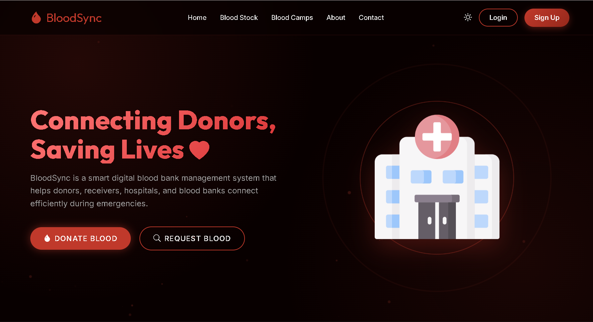
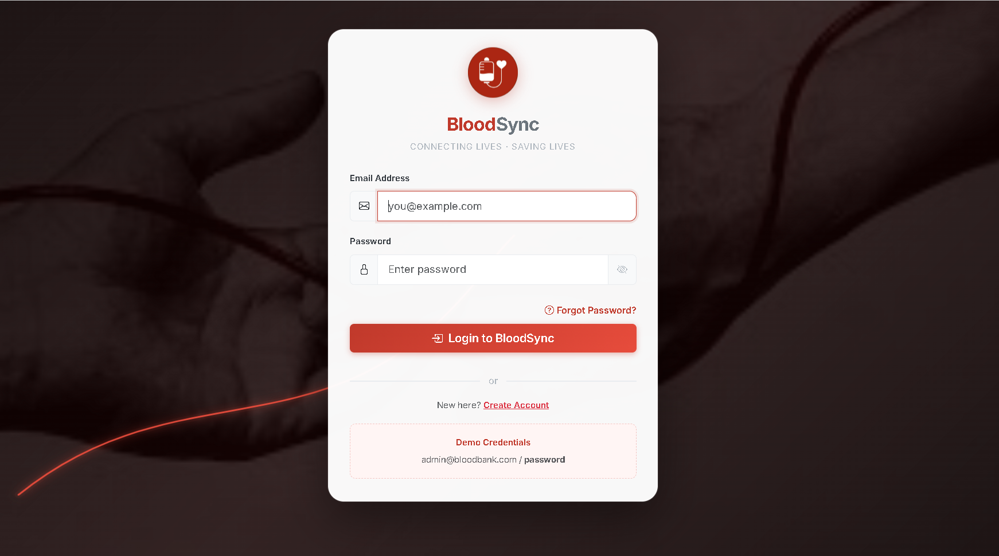
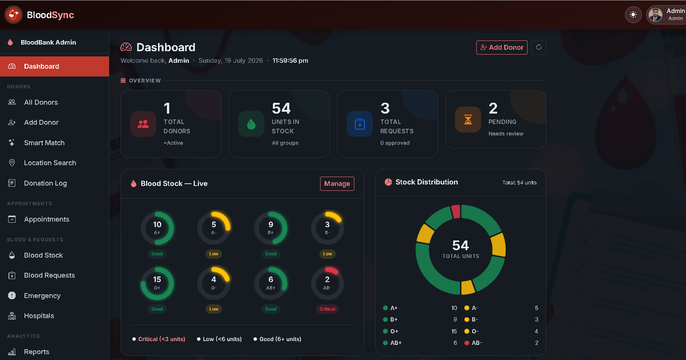
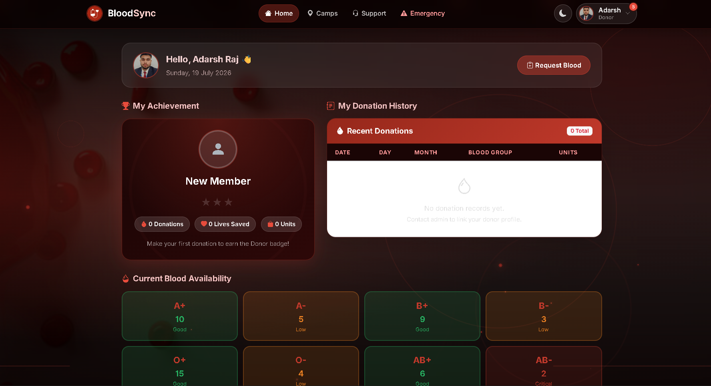

<div align="center">

```
██████╗ ██╗      ██████╗  ██████╗ ██████╗ ███████╗██╗   ██╗███╗   ██╗ ██████╗
██╔══██╗██║     ██╔═══██╗██╔═══██╗██╔══██╗██╔════╝╚██╗ ██╔╝████╗  ██║██╔════╝
██████╔╝██║     ██║   ██║██║   ██║██║  ██║███████╗ ╚████╔╝ ██╔██╗ ██║██║
██╔══██╗██║     ██║   ██║██║   ██║██║  ██║╚════██║  ╚██╔╝  ██║╚██╗██║██║
██████╔╝███████╗╚██████╔╝╚██████╔╝██████╔╝███████║   ██║   ██║ ╚████║╚██████╗
╚═════╝ ╚══════╝ ╚═════╝  ╚═════╝ ╚═════╝ ╚══════╝   ╚═╝   ╚═╝  ╚═══╝ ╚═════╝
```

### 🩸 *Connecting Donors. Saving Lives. One Drop at a Time.*

<br/>


</div>

---

## 📖 About the Project

**BloodSync** is a full-featured **Blood Bank Management System** built as a college final-year project. It bridges the gap between blood donors and recipients by providing a centralised, real-time platform to manage blood inventory, handle emergency requests, schedule donation camps, and coordinate with hospitals — all through a clean and responsive web interface.

Whether you're an admin managing a blood bank or a user looking to donate or request blood, BloodSync has you covered.

> 🎓 **College:** CIMAGE Professional College, Patna  
> 🧑‍🎓 **Course:** Bachelor of Computer Applications (BCA)  
> 📅 **Academic Year:** 2023 – 2026

---

## ✨ Key Features

### 👤 User Panel
- 🔐 Secure registration with **OTP-based email verification**
- 🩸 Submit and track **blood requests**
- 🚨 Raise **emergency blood alerts**
- 📅 **Book donation appointments** at registered camps
- 🏕️ Browse upcoming **donation camps**
- 🔔 Real-time **notifications**
- 💬 **Support & ticket** submission system
- 👤 Manage and update **personal profile**

### 🛠️ Admin Panel
- 📊 Live **admin dashboard** with real-time analytics
- 🧑‍🤝‍🧑 Full **donor management** (add, edit, view donors)
- 🩺 Manage **blood requests** and approve/reject them
- 🏥 Register and manage **hospitals**
- 🗃️ Track **blood stock** by blood group in real time
- 📋 **Appointment management** and scheduling
- 🤖 **Smart Match** — AI-assisted donor-to-recipient matching
- 📍 **Location-based search** for nearby donors
- 📆 **Monthly reports** and donation logs
- 📰 **Activity log** for full audit trail
- 👥 **User management** (block/unblock accounts)
- 🔔 Send targeted **notifications** to users

### 🔒 Authentication System
- Email + password login with **session management**
- **OTP verification** on registration via PHPMailer (SMTP)
- **Forgot password** with secure email reset link
- **Reset password** with token validation and expiry

---

## 🛠️ Tech Stack

| Layer | Technology |
|---|---|
| **Backend** | PHP 8.0+ (procedural + OOP) |
| **Database** | MySQL 8.0 via MySQLi |
| **Frontend** | HTML5, CSS3, Bootstrap 5, Vanilla JS |
| **Email** | PHPMailer 6.x (SMTP / Gmail) |
| **Server** | Apache (XAMPP on Windows / Linux) |
| **Icons** | Font Awesome 6 |
| **Charts** | Chart.js |
| **Maps / Location** | Browser Geolocation API |

---

## 📸 Screenshots

> 📌 *Replace the placeholder paths below with actual screenshots from your deployment.*

| Page | Preview |
|---|---|
| 🏠 Landing Page |  |
| 🔐 Login / Register |  |
| 📊 Admin Dashboard |  |
| 🩸 Blood Stock |  |
| 👤 User Dashboard |  |
| 🚨 Emergency Request |  |

> 💡 **Tip:** Add a `screenshots/` folder to your repo and drop in your `.png` files to make these appear automatically.

---

## ⚙️ Installation & Setup

### Prerequisites
Make sure you have the following installed:
- [XAMPP](https://www.apachefriends.org/) (PHP 8.0+, MySQL 8.0, Apache)
- A web browser (Chrome / Firefox recommended)
- A Gmail account (for SMTP email sending)

### 1️⃣ Clone the Repository

```bash
git clone https://github.com/BCA-310-22989-AdarshRaj/BloodSync.git
cd BloodSync
```

Move the project into your XAMPP `htdocs` folder:

```bash
# Windows
move BloodSync C:\xampp\htdocs\blood_bank

# Linux / Mac
mv BloodSync /opt/lampp/htdocs/blood_bank
```

### 2️⃣ Set Up the Database

1. Start **Apache** and **MySQL** from the XAMPP Control Panel.
2. Open [http://localhost/phpmyadmin](http://localhost/phpmyadmin)
3. Create a new database named `blood_bank`
4. Import the SQL files **in this exact order**:

```
database/blood_bank.sql          ← Base schema
database/migrate_features.sql    ← Feature tables
database/migrate_v2_auth.sql     ← OTP & auth
database/migrate_v3_user_panel.sql
database/migrate_v4.sql
database/migrate_v5_admin.sql    ← Admin extras
```

### 3️⃣ Configure the Database

Copy the example config and fill in your credentials:

```bash
cp config/db.example.php config/db.php
```

Edit `config/db.php`:

```php
define('DB_HOST', 'localhost');
define('DB_USER', 'root');          // your MySQL username
define('DB_PASS', '');              // your MySQL password
define('DB_NAME', 'blood_bank');
```

### 4️⃣ Configure Email (SMTP)

Edit `config/mail_config.php`:

```php
define('MAIL_HOST',     'smtp.gmail.com');
define('MAIL_USERNAME', 'your_email@gmail.com');
define('MAIL_PASSWORD', 'your_app_password');   // Gmail App Password, NOT your login password
define('MAIL_PORT',     587);
define('MAIL_FROM',     'your_email@gmail.com');
define('MAIL_FROM_NAME','BloodSync');
```

> 💡 Generate a Gmail **App Password** at: https://myaccount.google.com/apppasswords  
> (Requires 2-Step Verification to be enabled on your Gmail account)

### 5️⃣ Run the Project

Open your browser and go to:

```
http://localhost/blood_bank/
```

---

## 🚀 Usage

| Role | Default URL | Credentials |
|---|---|---|
| 🏠 **Landing Page** | `http://localhost/blood_bank/` | — |
| 👤 **User Login** | `http://localhost/blood_bank/auth/login.php` | Register a new account |
| 🛠️ **Admin Login** | `http://localhost/blood_bank/auth/login.php` | Set up admin user via DB |

To create an **admin account**, insert directly into the `users` table in phpMyAdmin:

```sql
INSERT INTO users (name, email, password, role, is_verified)
VALUES ('Admin', 'admin@bloodsync.com', MD5('Admin@123'), 'admin', 1);
```

---

## 🗂️ Project Structure

```
blood_bank/
│
├── 📁 admin/                  # Admin panel pages
│   ├── dashboard.php          # Live analytics dashboard
│   ├── blood_stock.php        # Blood inventory management
│   ├── donors.php             # Donor list & management
│   ├── requests.php           # Blood request management
│   ├── appointments.php       # Appointment scheduling
│   ├── hospitals.php          # Hospital directory
│   ├── emergency.php          # Emergency alerts
│   ├── smart_match.php        # AI-assisted donor matching
│   ├── location_search.php    # Location-based donor search
│   ├── manage_users.php       # User management & blocking
│   ├── monthly_report.php     # Monthly analytics report
│   ├── activity_log.php       # Full audit trail
│   └── notifications.php      # Push notifications
│
├── 📁 auth/                   # Authentication system
│   ├── login.php              # Login page
│   ├── register.php           # Registration + OTP
│   ├── verify_otp.php         # OTP verification
│   ├── forgot_password.php    # Password reset request
│   └── reset_password.php     # New password form
│
├── 📁 user/                   # User panel pages
│   ├── dashboard.php          # User home
│   ├── request_blood.php      # Blood request form
│   ├── emergency.php          # Emergency request
│   ├── book_appointment.php   # Camp appointment booking
│   ├── camps.php              # Donation camp listings
│   ├── profile.php            # Profile management
│   ├── notifications.php      # User notifications
│   └── support.php            # Help & support tickets
│
├── 📁 config/                 # Configuration files
│   ├── db.php                 # Database connection (⚠️ excluded from Git)
│   └── mail_config.php        # SMTP email config (⚠️ excluded from Git)
│
├── 📁 includes/               # Shared components
│   ├── PHPMailer/             # PHPMailer library
│   ├── admin_header.php       # Admin nav/sidebar
│   ├── user_header.php        # User navigation
│   ├── sidebar.php            # Admin sidebar
│   ├── footer.php             # Page footer
│   └── activity.php           # Activity logging helper
│
├── 📁 assets/                 # Static files
│   ├── css/landing.css        # Landing page styles
│   ├── js/landing.js          # Landing page scripts
│   ├── style.css              # Global styles
│   └── dark_fix.css           # Dark mode overrides
│
├── 📁 database/               # SQL migration files
│   ├── blood_bank.sql         # Base schema
│   └── migrate_*.sql          # Versioned migrations
│
└── index.php                  # Landing / home page
```

---

## 🔮 Future Enhancements

- [ ] 📱 **Progressive Web App (PWA)** — Offline support and mobile install
- [ ] 🗺️ **Google Maps integration** — Visual donor location map
- [ ] 📲 **SMS OTP** — Two-factor authentication via Twilio/Fast2SMS
- [ ] 📊 **Advanced analytics** — Donation trends, heatmaps, blood shortage alerts
- [ ] 🤖 **AI recommendation engine** — Smart donor suggestions based on history
- [ ] 🏥 **Hospital portal** — Dedicated login for partner hospitals
- [ ] 🔗 **REST API** — For future mobile app (Android/iOS) integration
- [ ] 🌐 **Multi-language support** — Hindi + English UI toggle
- [ ] 📧 **Newsletter / camp announcements** — Bulk email campaigns

---

## 🤝 Contributing

Contributions are welcome, especially from fellow students! Here's how:

1. **Fork** this repository
2. **Create** a feature branch:
   ```bash
   git checkout -b feature/your-feature-name
   ```
3. **Commit** your changes:
   ```bash
   git commit -m "Add: description of your feature"
   ```
4. **Push** to your fork:
   ```bash
   git push origin feature/your-feature-name
   ```
5. Open a **Pull Request** and describe what you changed

> 💡 Please keep code clean, commented, and consistent with the existing style. Test all changes locally before submitting.

---

## 📄 License

This project is licensed under the **MIT License** — you are free to use, modify, and distribute it with attribution.

```
MIT License

Copyright (c) 2026 Adarsh Raj

Permission is hereby granted, free of charge, to any person obtaining a copy
of this software and associated documentation files (the "Software"), to deal
in the Software without restriction, including without limitation the rights
to use, copy, modify, merge, publish, distribute, sublicense, and/or sell
copies of the Software, and to permit persons to whom the Software is
furnished to do so, subject to the following conditions:

The above copyright notice and this permission notice shall be included in all
copies or substantial portions of the Software.
```

See the full [LICENSE](./LICENSE) file for details.

---

## 📬 Contact & Credits

<div align="center">

| | |
|---|---|
| 👤 **Author** | Adarsh Raj |
| 🎓 **Institution** | CIMAGE Professional College, Patna |
| 📧 **Email** | [adarsh.bcastudent23.22989@cimage.in](mailto:adarsh.bcastudent23.22989@cimage.in) |
| 🐙 **GitHub** | [@BCA-310-22989-AdarshRaj](https://github.com/BCA-310-22989-AdarshRaj) |
| 📦 **Repository** | [BloodSync](https://github.com/BCA-310-22989-AdarshRaj/BloodSync) |

</div>

---

<div align="center">

### 🩸 *"Every drop counts. Every donor matters."*

Made with ❤️ by **Adarsh Raj** as part of the BCA Final Year Project

⭐ If you found this project helpful or inspiring, please **star the repo** — it means a lot!

[](https://github.com/BCA-310-22989-AdarshRaj/BloodSync/stargazers)
[](https://github.com/BCA-310-22989-AdarshRaj/BloodSync/network/members)

</div>
